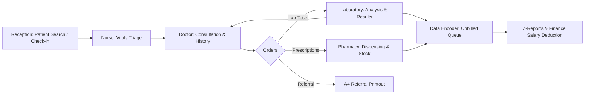
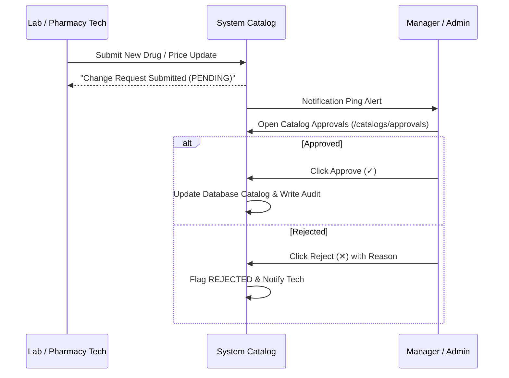

# Comprehensive Operations & User Manual
## Clinic Management & Healthcare ERP System (Bure Card Clinic)
**Document Version:** 1.0  
**Target Release:** Production v0.1.29  
**System Classification:** Internal Healthcare & Payroll Deduction ERP  
**Operating Jurisdiction & Timezone:** Ethiopia (Africa/Addis_Ababa, E.C. Calendar)  

---

> ### Notice for Document Formatting & Claude .docx Conversion
> This Markdown document is designed as the master source for generating the official **User & System Operations Manual (.docx)**.
> - **Screenshots:** Standardized screenshot callouts (`> 📷 **SCREENSHOT PLACEHOLDER:** ...`) are embedded across every section. When converting to `.docx`, replace each callout or embed the corresponding capture with a centered caption.
> - **Callouts & Alerts:** Standard GitHub alerts (`> [!NOTE]`, `> [!IMPORTANT]`, `> [!TIP]`, `> [!WARNING]`) should be rendered as styled callout boxes or callout tables in Word.
> - **Tables & Matrices:** All tables are formatted with header rows and consistent cell alignment suitable for automatic conversion into clean Word tables.

---

# Table of Contents
1. [Executive Summary & System Architecture](#1-executive-summary--system-architecture)
2. [Role-Based Access Control (RBAC) Matrix](#2-role-based-access-control-rbac-matrix)
3. [Module 1: Authentication, Station Presence & Global Navigation](#3-module-1-authentication-station-presence--global-navigation)
4. [Module 2: Patient Registration & Demographic Management](#4-module-2-patient-registration--demographic-management)
5. [Module 3: Reception, OPD Routing & Queue Management](#5-module-3-reception-opd-routing--queue-management)
6. [Module 4: Nurse Triage & Vital Signs Recording](#6-module-4-nurse-triage--vital-signs-recording)
7. [Module 5: Doctor Consultation, Clinical History & Orders](#7-module-5-doctor-consultation-clinical-history--orders)
8. [Module 6: Laboratory & Diagnostic Testing](#8-module-6-laboratory--diagnostic-testing)
9. [Module 7: Pharmacy Dispensing & Inventory Control](#9-module-7-pharmacy-dispensing--inventory-control)
10. [Module 8: Data Encoder, Billing & Financial Z-Reports](#10-module-8-data-encoder-billing--financial-z-reports)
11. [Module 9: Executive Management Dashboard](#11-module-9-executive-management-dashboard)
12. [Module 10: System Administration & Global Configuration](#12-module-10-system-administration--global-configuration)
13. [Module 11: Catalog Governance & Approval Workflow](#13-module-11-catalog-governance--approval-workflow)
14. [Module 12: Audit Logging & Security Compliance](#14-module-12-audit-logging--security-compliance)
15. [Module 13: System Deployment, Backups & Maintenance](#15-module-13-system-deployment-backups--maintenance)
16. [Appendices: Discount Rules, Calendars, Shortcuts & Glossary](#16-appendices)

---

# 1. Executive Summary & System Architecture

### 1.1 Purpose & Scope
The **Bure Card Clinic Management ERP** is an integrated clinical and financial management system designed specifically for enterprise and institutional clinics serving staff, soldiers, and their registered dependents. The platform unifies patient registration, nursing triage, outpatient medical consultation (OPD), diagnostic laboratory panels, pharmacy dispensing with strict inventory management, credit-based billing, and payroll salary deduction accounting.

### 1.2 Core Architectural Principles
- **No Cash at Consultation:** Patients receive clinical care on credit. Civilian staff and family bills automatically aggregate under the employee's payroll ID for monthly salary deduction. Active military personnel receive 100% institutional healthcare coverage.
- **Dynamic Ethiopian Calendar (E.C.) Tenure Discounts:** Rather than arbitrary or static pricing, discounts are calculated dynamically based on tenure (`permanentSince` Ethiopian hired year) and snapshotted onto every invoice at checkout.
- **OPD Queue Auto-Balancing:** Reception check-ins dynamically distribute incoming patients to active outpatient rooms (OPD 1–5) based on real-time doctor occupancy and minimum queue count.
- **Timezone Integrity:** All operations are locked to `Africa/Addis_Ababa`. Daily queues automatically reset every morning at 00:00 local time, preventing stale queues from previous days.
- **Selective Diagnostic Testing:** Physicians can order either comprehensive laboratory panels (Complete Hematology/CBC, Stool Examination, Urine Examination) or isolate specific sub-tests (e.g., Occult Blood FOBT, Ova & Parasite, Dipstick Albumin/Sugar) without inflating costs or generating fragmented technician requests.
- **Dual Paper & Digital Trail:** While transactions, stock movements, and results are digitally recorded, the system produces one-page formatted printouts for patient paper cards, A4 single-page medical referral letters, pharmacy signature ledgers, and financial payroll vouchers.



---

# 2. Role-Based Access Control (RBAC) Matrix

The system enforces strict server-side authorization through resource-action permissions. Merely hiding buttons on the frontend is never sufficient; all server actions and route handlers authenticate, authorize, and audit every operation.

| System Role | Primary Workstations | Core Permissions & Operational Capabilities |
| :--- | :--- | :--- |
| **Receptionist** | `/patients`, `/visits`, `/dashboard` | Register new patients; fast search by phone/ID/name; check-in patients to active OPDs; toggle room availability; cancel waiting appointments; print daily patient directories. |
| **Nurse** | `/dashboard` (Nurse View) | Review waiting patient queue; record and update vital signs (Weight, Blood Pressure, Temperature, Heart Rate); save triage assessments. |
| **Doctor** | `/dashboard`, `/visits`, `/patients/[id]` | Set active OPD station; review assigned queue; record diagnoses and SOAP notes; enter paper-record history; order selective lab panels; prescribe medications; generate A4 referral sheets; schedule follow-ups; review unread lab alerts. |
| **Laboratory** | `/laboratory`, `/laboratory/catalog` | View pending and urgent test requests; enter structured results for Hematology, Stool, Urine, and special tests; use "Fill Requested Normal" shortcuts; toggle equipment operational status; submit test catalog additions/price changes. |
| **Pharmacy** | `/pharmacy`, `/pharmacy/catalog` | View active prescription queue; dispense medications with automated First-Expired-First-Out (FEFO) batch deduction; print signature receipts; reconcile stock with Hamle baseline in Temporary Tracking; manage batches; submit drug catalog changes. |
| **Data Encoder / Cashier** | `/dataencoder`, `/dataencoder/z-reports` | Review real-time unbilled transactions from Lab and Pharmacy; verify applied tenure discounts; approve or disapprove invoices; generate daily/monthly Z-Reports; aggregate dependent expenses to primary staff for salary deductions; export Excel payroll ledgers. |
| **Manager** | `/dashboard` (Executive View), `/catalogs/approvals` | Monitor clinical KPIs, revenue, stock levels, and expiry alerts; review and approve/reject proposed catalog changes; supervise patient demographic locks; view clinical audits. |
| **Administrator** | `/admin`, `/audit`, `/dashboard` | Create and deactivate user accounts; manage roles and passwords; configure clinic profile (bilingual names and logo); set global OPD room limits; toggle performance modes (Low Power, Heavy Duty, Auto-Pilot); initiate database backups and system self-updates; view security audit logs. |

---

# 3. Module 1: Authentication, Station Presence & Global Navigation

### 3.1 Overview & System Entry
Access to the clinic portal is strictly governed by authenticated sessions. Users log in using their registered email address and credentials. Deactivated staff accounts are immediately rejected upon session verification.

> 📷 **SCREENSHOT PLACEHOLDER:**  
> ``

### 3.2 Global Sidebar Navigation
The left sidebar provides role-tailored navigation items:
- **Clinic Branding:** Displays the institution's official logo and clinic name as configured in System Settings.
- **Language Switcher:** Allows 1-click toggling between **English** and **Amharic (አማርኛ)** across all core navigation links and alerts.
- **Role Badge & User Profile:** Shows the currently authenticated user's name, assigned role, active station status, and system build version hash.
- **Dark / Light Theme Toggle:** Located in the top navigation bar for low-glare night shift environments.

### 3.3 Doctor Station Presence ("My Station")
Before conducting consultations, doctors must establish their physical presence:
1. Locate the **My Station** dropdown in the top-left section of the sidebar.
2. Select your currently occupied OPD room (e.g., `OPD Room 1`, `OPD Room 2`, etc.).
3. The system instantly broadcasts this presence to the entire clinic:
   - Receptionists see a pulsing **glowing green dot** next to the physician's name.
   - New check-in routing directs patients assigned to that doctor straight to the occupied room.
   - The doctor's dashboard filters today's queue exclusively to patients routed to that room.

> 📷 **SCREENSHOT PLACEHOLDER:**  
> ``

### 3.4 Interactive In-App Tutorial System
For rapid onboarding of new healthcare personnel:
- Press the `?` keyboard key anywhere in the application, or click the **Help Tour** button in the sidebar footer.
- An interactive, bilingual walkthrough card opens, guiding the user through every feature of their workstation.
- Tutorial progress adapts dynamically to the active role and page route.

---

# 4. Module 2: Patient Registration & Demographic Management

### 4.1 Overview & Patient Types
The patient registry is the foundation of the clinic. The system supports 8 distinct patient classifications with hardcoded financial benefit policies:

```
+----------------------------------------------------------------------------------+
|                            PATIENT CLASSIFICATIONS                               |
+--------------------------+-----------------------+-------------------------------+
| Patient Type             | Identification Fields | Discount / Billing Policy     |
+--------------------------+-----------------------+-------------------------------+
| 1. Soldier               | Military ID, Rank,    | 100% Free institutional care  |
|                          | Division              |                               |
| 2. Soldier Family        | Linked Military ID,   | 100% Free institutional care  |
|                          | Relationship          |                               |
| 3. Civilian Staff (0-5y) | Employee ID, Hired Yr | 50% Discount on services      |
| 4. Civilian Staff (6-9y) | Employee ID, Hired Yr | 55% Discount on services      |
| 5. Civilian Staff(10-14y)| Employee ID, Hired Yr | 65% Discount on services      |
| 6. Civilian Staff(15-19y)| Employee ID, Hired Yr | 75% Discount on services      |
| 7. Civilian Staff (20y+) | Employee ID, Hired Yr | 100% Free tenure benefit      |
| 8. Civilian Family       | Linked Staff ID,      | 5% Patient Discount;          |
|                          | Relationship          | 95% Deducted from Staff Salary|
| 9. Guest Attendee        | Contact Number        | 0% Discount (Standard Cashier)|
+--------------------------+-----------------------+-------------------------------+
```

### 4.2 Patient Directory & Fast Predictive Search
Located at `/patients`, the directory provides instant search across the entire historical registry:
- **Multi-Token Matching:** Search simultaneously by full name, phone number, card number, employee ID, or military ID.
- **Phone Variant Normalization:** Numeric input automatically searches across Ethiopian formats: local `09...`, international `+2519...`, or bare digits `9...`.
- **Primary Staff Link Search:** Searching an employee's ID or phone number automatically surfaces both the employee and all their linked dependents.
- **Keystroke Debouncing:** Table rows filter with a responsive 120ms debounce without jarring UI layout shifts.

> 📷 **SCREENSHOT PLACEHOLDER:**  
> ``

### 4.3 Registering a New Patient (`/patients/new`)
To register a new patient:
1. Navigate to **Patients** -> click **+ New Patient**.
2. **Personal Information:** Enter First Name, Last Name, Gender, and Contact Mobile Number.
3. **Age & Birth Year:** Enter Age directly, or input the birth year in the Ethiopian Calendar (`E.C.`). The system automatically reconciles current Ethiopian year math.
4. **Select Patient Type:**
   - **If Soldier:** Complete the required military fields: **Military ID Number**, **Rank**, and **Division/Unit**.
   - **If Civilian Staff:** Complete **Employee ID**, **Department**, and select **Permanent Since (ቋሚ የሆነበት ቀን)** using the Ethiopian Date Picker. If this date is unknown at registration, the record is flagged for later update.
   - **If Civilian Family or Soldier Family:** The **Family Link Selector** appears. Type the primary staff/soldier's phone number, employee ID, or name. Select the primary member from the dropdown, then specify the relationship (e.g., *Spouse*, *Child*, *Parent*).
5. **Physical Paperwork Verification:** If physical ID/paperwork was inspected at the desk, toggle the paperwork verification checkbox.
6. Click **Register Patient**. The user is immediately redirected to the new Patient Profile.

> 📷 **SCREENSHOT PLACEHOLDER:**  
> ``

### 4.4 Demographic Data Locking
To preserve accounting and clinical integrity:
- Once registered, patient demographics are locked against routine edits.
- Only users with **Admin** or **Manager** roles can modify existing names, military IDs, or hired dates.
- Receptionists retain a 24-hour grace window only for non-soldier records with missing permanent hired dates.

---

# 5. Module 3: Reception, OPD Routing & Queue Management

### 5.1 Reception Command Center (`/dashboard` & `/visits`)
When a user with the **Receptionist** role logs in, they land directly on the Reception Command Center. The dashboard displays the real-time status of all outpatient diagnosis rooms (OPD 1 through OPD 5).

> 📷 **SCREENSHOT PLACEHOLDER:**  
> ``

### 5.2 Patient Check-In Procedure
1. Locate the **Patient Check-in / Visit Scheduler** card on top of the dashboard.
2. Search for the patient in the auto-complete search field.
3. The system presents the **Top Predicted Match** banner. Verify the patient's card number and name.
4. **Routing Selection:**
   - **Option A (Auto-Balanced Queue):** Leave the Doctor selection blank. The system automatically computes which active OPD room currently has the lowest waiting queue and assigns the patient there.
   - **Option B (Specific Physician Appointment):** Select a specific doctor. If that doctor is currently online in an OPD room, the visit is routed directly to that room.
5. Click **Check In Patient** (or press Enter).
6. A confirmation modal appears displaying the assigned **OPD Room Number** and daily queue ticket. Inform the patient which room to proceed to.

> 📷 **SCREENSHOT PLACEHOLDER:**  
> ``

### 5.3 OPD Room Availability & Morning Queue Reset
- **Room On/Off Toggle:** Receptionists can toggle any OPD room active or inactive. When a room is toggled off (e.g., doctor attending emergency or off-duty), auto-assignment bypasses that room entirely.
- **Cancel Visit:** If a patient leaves without being seen, click the red **X** button on their queue card to transition the visit to `CANCELLED`.
- **Automated Morning Queue Reset:** Visits are scoped strictly to the clinic's local day (`Africa/Addis_Ababa`). Any un-attended visits from the previous calendar day automatically expire at midnight to ensure the morning queue begins completely clean.

---

# 6. Module 4: Nurse Triage & Vital Signs Recording

### 6.1 Overview
The nursing module acts as the clinical bridge between Reception check-in and Doctor consultation. Nurses record baseline physiologic measurements before the physician begins examination.

> 📷 **SCREENSHOT PLACEHOLDER:**  
> ``

### 6.2 Step-by-Step Vitals Capture
1. In the **Nurse Triage Dashboard**, locate the patient waiting under their assigned OPD room.
2. In the quick-entry vitals fields, enter:
   - **Weight:** In kilograms (e.g., `68.5 kg`).
   - **Blood Pressure (BP):** Systolic over diastolic in mmHg (e.g., `120/80`).
   - **Temperature:** In degrees Celsius (e.g., `36.8 °C`).
   - **Heart Rate (Pulse):** In beats per minute (e.g., `72 bpm`).
3. Click **Save Vitals**.
4. The patient card updates with a green **Vitals Recorded** badge. The data synchronizes instantly to the doctor's consultation view without requiring page reloads.

---

# 7. Module 5: Doctor Consultation, Clinical History & Orders

### 7.1 Doctor Command Center
The Doctor Dashboard (`/dashboard`) provides a focused, single-pane workstation:
- **Operating Station Indicator:** Displays current active OPD room.
- **Weekly Appointments Card:** Displays scheduled patient consultations for the week.
- **Patients Awaiting Review Counter:** Shows patients whose diagnostic lab tests have completed and are waiting for clinical decision.
- **Active OPD Queue:** Displays today's patients waiting specifically in this doctor's room, sorted by check-in time with urgent laboratory status indicators.

> 📷 **SCREENSHOT PLACEHOLDER:**  
> ``

### 7.2 Patient Profile & Medical History (`/patients/[id]`)
Opening any patient brings up their unified electronic medical record (EMR):
- **Header Demographics:** Full name, age, gender, contact number, military or employee ID, and permanent hired tenure date.
- **Family Tree & Dependents:** If viewing a staff member, shows all registered family members and their respective benefit tiers. If viewing a dependent, displays a link to the primary sponsor.
- **Clinical SOAP Notes:** Structured medical notes divided into Subjective, Objective, Assessment, and Plan.
- **Paper-Trail Digitization Form:** For clinics migrating older physical archives, physicians can record legacy historical consultations by specifying the original physical record date with source flagged as `paper_import`.

> 📷 **SCREENSHOT PLACEHOLDER:**  
> ``

### 7.3 Doctor Diagnostic Lab Orders (Chip Card Interface)
Doctors order laboratory tests directly inside the consultation view:
- **Interactive Chip Cards:** Tests are displayed as clean, clickable cards with real-time price indicators.
- **URGENT Priority Toggle:** Checking the `⚡ Urgent Request` switch marks the test order with high-visibility red badges on laboratory queues.
- **Selective Sub-Test Ordering:** Instead of forcing complete panels, doctors can click the dropdown arrow on major panels to select only what is clinically required:
  - **Hematology (CBC) Sub-Tests:** Choose full CBC or individual items: *WBC + Differential*, *Hemoglobin & Hematocrit*, *Platelet Count*, *ESR (Erythrocyte Sedimentation Rate)*, *Coagulation / Bleeding Time*, or *Blood Morphology*.
  - **Stool Examination Sub-Tests:** Choose full analysis or individual items: *Occult Blood (FOBT)*, *Ova & Parasite (Microscopic)*, or *Macroscopic Appearance & Consistency*.
  - **Urine Examination Sub-Tests:** Choose routine urinalysis or individual items: *Physical Examination (Reaction/pH, Specific Gravity)*, *Chemical Dipstick (Albumin & Sugar)*, or *Microscopic Sediment*.
- **Combined Request Dispatch:** All selected sub-tests are combined into a single unified requisition so the lab technician processes them together.

> 📷 **SCREENSHOT PLACEHOLDER:**  
> ``

### 7.4 Electronic Prescription Ordering
1. Under the **Prescription Orders** section, search for medications from the approved drug catalog.
2. Enter the prescribed **Quantity** and clinical **Administration Instructions** (e.g., *1 capsule PO TID for 5 days after meals*).
3. Click **+ Add Item** to include multiple drugs on the same prescription.
4. Click **Submit Prescription**. The order dispatches immediately to the Pharmacy dispensing queue.

> 📷 **SCREENSHOT PLACEHOLDER:**  
> ``

### 7.5 Single-Page A4 Medical Referral Generator
When a patient requires escalation to external specialized hospitals:
1. Click the **Referral Letter** button in the clinical orders panel.
2. The referral sheet pre-populates the patient's full name, age, gender, rank, unit, and the referring clinic's bilingual institutional header.
3. Complete the clinical referral sections:
   - **Referred To:** Target facility or specialist clinic.
   - **Brief History & Physical Findings:** Presenting complaints and clinical signs.
   - **Lab & X-Ray Findings:** Key diagnostic findings.
   - **Working Diagnosis:** Confirmed or differential diagnosis.
   - **Treatment Given:** Medications and procedures already administered.
   - **Recommendation:** Purpose of referral and requested specialty care.
4. Click **Print Referral**. The system applies specialized print CSS enforcing an exact **1-page fit on standard A4 paper**, preventing unnecessary overflow onto a second page.

> 📷 **SCREENSHOT PLACEHOLDER:**  
> ``

---

# 8. Module 6: Laboratory & Diagnostic Testing

### 8.1 Laboratory Workbench (`/laboratory`)
The laboratory workstation provides a dual-column display:
- **Left Column (Pending Tests):** Displays incoming test requests sorted by submission time. Urgent requests pulse with a red badge. Requests containing multiple panel sub-tests display a **Combined Request** tag.
- **Right Column (Completed History):** Chronological log of analyzed samples and verified findings.

> 📷 **SCREENSHOT PLACEHOLDER:**  
> ``

### 8.2 Structured Laboratory Result Entry
Clicking **Enter Results** opens the dedicated panel form tailored to the test type:

#### A. Complete Hematology / CBC Panel
- **White Blood Cell (WBC) Count & Differential:** Neutrophils (%), Bands (%), Lymphocytes (%), Monocytes (%), Eosinophils (%), Basophils (%), Blasts (%), Myelocytes (%).
- **Red Blood Cell (RBC) & Indices:** Total RBC count, Hemoglobin (g/dL), Hematocrit (%), MCV (fL), MCH (pg), MCHC (g/dL), Reticulocyte count (%).
- **Platelets & Hemostasis:** Platelet count, Bleeding Time (BT), Coagulation Time (CT), Prothrombin Time (PT), Erythrocyte Sedimentation Rate (ESR mm/hr).
- **Morphology & Remarks:** Open text fields for blood film observations.

#### B. Stool Examination Panel
- **Macroscopic:** Appearance (Formed, Soft, Liquid), Consistency, Gross Blood (Present/Absent), Pus, Mucus, Bile pigment.
- **Chemical:** Occult Blood (FOBT) (Negative / Weakly Positive / Strongly Positive).
- **Microscopic:** Ova & Parasites (Identification of cysts, ova, or trophozoites).

#### C. Routine Urinalysis Panel
- **Physical:** Total quantity, pH Reaction, Specific Gravity.
- **Chemical:** Albumin (Qualitative & Quantitative), Sugar/Glucose, Acetone/Ketones, Diacetic Acid, Bilirubin, Urobilinogen.
- **Microscopic Sediment:** Pus cells (HPF), RBCs (HPF), Epithelial cells, Casts, Crystals, Bacteria.

> 📷 **SCREENSHOT PLACEHOLDER:**  
> ``

### 8.3 "Fill Requested Normal" & Selective Validation
- **Visual Focus Indicators:** If the physician ordered only selected sub-tests (e.g., Occult Blood only), those specific fields are highlighted with high-contrast amber/blue focus rings and marked with `★ REQUIRED`. Non-requested sub-tests are flagged as `(Optional)`.
- **Fill Requested Normal Button:** Clicking this button automatically populates normal clinical baseline values across all requested fields with one click, allowing technicians to rapidly modify only abnormal parameters.
- **Instant Result Synchronization:** Submitting the results completes all linked sub-test requests in a single database transaction, sends an alert ping to the requesting doctor, and routes the billing charge to the Data Encoder.

---

# 9. Module 7: Pharmacy Dispensing & Inventory Control

### 9.1 Pharmacy Command Center (`/pharmacy`)
The pharmacy module manages medication dispensing, stock replenishment, and inventory auditing. The interface is organized into three specialized tabs:
1. **Prescriptions Queue**
2. **Inventory Management**
3. **Temporary Tracking Table (Hamle Reconciliation)**

> 📷 **SCREENSHOT PLACEHOLDER:**  
> ``

### 9.2 Dispensing Prescriptions & Automated FEFO Stock Deduction
1. Locate the pending prescription under the **Prescriptions** tab.
2. Review the prescribed medication, ordered quantity, and doctor instructions.
3. Click **Dispense Medication**:
   - The system queries active stock batches using **First-Expired-First-Out (FEFO)** logic.
   - Inventory is automatically deducted from the batch nearest to expiration.
   - If stock is insufficient, the system warns the pharmacist and prevents incomplete transactions.
4. Click **Print Receipt**:
   - Generates a formatted pharmacy receipt displaying patient name, medication names, batch numbers, dispensed quantities, and a **Patient Signature Line**.
   - The patient signs the physical receipt for pharmacy compliance records while the digital ledger updates simultaneously.

> 📷 **SCREENSHOT PLACEHOLDER:**  
> ``

### 9.3 Inventory Management & Batch Tracking
Under the **Inventory** tab:
- **Batch Registration:** Register new drug shipments with Batch Number, Expiration Date, Total Quantity, Unit Cost, and Delivery Document Number (`docNo`).
- **Low Stock & Expiry Alerts:** Medications with fewer than 500 units display amber warning badges; items below 100 units display red emergency warnings. Batches expiring within 30 days are automatically highlighted.
- **Stock Movements Audit:** Every adjustment (receive, dispense, manual correction, waste disposal) generates an immutable stock movement record linked to the acting user.

### 9.4 Temporary Tracking Table (Hamle Reconciliation)
To accommodate clinics transitioning large legacy medicine stocks without immediate batch categorization:
- Displays all catalog drugs mapped against the baseline **Hamle (ሐምሌ)** annual physical inventory.
- Columns: **Medicine Name**, **Hamle Baseline Stock**, **Current Stock Count**, **Discrepancy Status**, and **Quick Action**.
- Pharmacists can perform inline editing of current physical counts directly on the table. Changes immediately synchronize with the active drug catalog.
- **Excel Template Export/Import:** Supports 1-click download of the complete reconciliation ledger (`pharmacy-catalog-hamle-template.xlsx`) and bulk re-import after annual inventory audits.

> 📷 **SCREENSHOT PLACEHOLDER:**  
> ``

---

# 10. Module 8: Data Encoder, Billing & Financial Z-Reports

### 10.1 Overview & Credit Billing Architecture
Because patients are institutional staff or military personnel, billing operates entirely on credit without cash handling at the counter:
- Whenever the Pharmacy dispenses a prescription or the Laboratory verifies a result, an unbilled invoice item is automatically generated.
- The **Data Encoder** verifies the transactions, confirms the applied tenure discount, and submits the charges to Finance for payroll deduction.

> 📷 **SCREENSHOT PLACEHOLDER:**  
> ``

### 10.2 Dynamic Tenure Discount Engine
The system calculates discounts using the employee's verified tenure:
- **Dynamic EC Year Math:** When an employee is registered with a `permanentSince` year (e.g., `2008 E.C.`), tenure is calculated against the current Ethiopian calendar year (`currentYear - hiredYear`).
- **Financial Snapshotting:** When an invoice is created, the discount rate is snapshotted into `discountPercentApplied`. Subsequent policy changes or tenure increments never alter historical closed invoices.
- **Civilian Family 5% / 95% Rule:** For civilian family members, 5% is granted as an immediate direct discount, while the remaining 95% is charged as credit attributed directly to the primary staff sponsor's employee ID.

### 10.3 Invoice Approval Workflow
Under `/dataencoder`:
1. Use the **Ethiopian Date Range Filter** (`From Date` and `To Date`) to isolate daily or weekly batches.
2. Review the transaction row:
   - **Invoice Number** & Date.
   - **Patient Name & Type** (Staff, Soldier, Family, Dependent).
   - **Laboratory Cost** & **Pharmacy Cost**.
   - **Discount Percentage** & **Discounted Subsidized Amount**.
   - **Net Amount Due**.
3. Click the green **Approve (✓)** button to confirm the charge. If a test was cancelled or disputed, click the red **Disapprove (✕)** button to return it for audit.

### 10.4 Financial Z-Reports & Payroll Salary Deduction Ledger (`/dataencoder/z-reports`)
The Z-Reports module is the definitive financial export center for the institutional Finance Department:
- **Summary KPI Banner:** Shows Total Gross Billing, Total Subsidies/Discounts Absorbed, Net Collectible Balance, Laboratory Department Share, and Pharmacy Department Share.
- **Cashier & Encoder Attribution:** Filters transactions by the specific encoder or cashier who approved the charge.
- **Dual Presentation Views:**
  1. **Grouped Staff Credit View (Payroll Mode):** Consolidates all transactions under the primary staff member's Employee ID. If a staff member, their spouse, and two children received care, all expenses roll up into one line item showing total transactions, covered family members, and net payroll deduction.
  2. **Individual Transaction View (Audit Mode):** Detailed line-by-line audit showing individual prescriptions, lab tests, and timestamps.
- **Services Detail Popup:** Clicking any grouped employee row opens a detailed slide-out listing every clinical service received across all dates.
- **Printable Financial Voucher:** Generates official institutional deduction vouchers with bilingual headers and signature boxes for the Finance Officer.
- **Excel Spreadsheet Export:** 1-click export of the entire consolidated payroll ledger directly to `.xlsx` for import into company payroll systems.

> 📷 **SCREENSHOT PLACEHOLDER:**  
> ``

---

# 11. Module 9: Executive Management Dashboard

### 11.1 Executive Overview (`/dashboard` for Manager)
The Executive Dashboard provides hospital managers and clinic supervisors with real-time operational intelligence across all clinical and financial departments.

> 📷 **SCREENSHOT PLACEHOLDER:**  
> ``

### 11.2 Key Metrics & Analytics
- **Patient Census & Flow:**
  - Total registered patient archive.
  - Active inpatients admitted vs outpatients.
  - Admitted consultations today vs completed consultations.
  - Real-time queue volume across active waiting rooms.
  - Demographic distribution chart (Soldier, Civilian Staff, Civilian Family, Guests).
- **Pharmacy Safety & Financial Exposure:**
  - Total registered active drug molecules.
  - Total warehouse units in stock.
  - Critical stock warnings (Out of Stock count, Low Stock <500 count).
  - Expired batch count and total financial loss value in minor currency units.
  - Batches approaching expiration within 30 days.
- **Financial Performance:**
  - Today's net approved revenue.
  - Today's institutional discounts subsidized.
  - All-time cumulative revenue.
  - Pending unbilled invoice value.
- **Live OPD Room Status:**
  - Grid showing OPD Rooms 1 through 5.
  - Real-time doctor occupancy and active patient queue count per room.

---

# 12. Module 10: System Administration & Global Configuration

### 12.1 Administration Console (`/admin`)
The administration module is restricted exclusively to the **Admin** role. It houses system governance, user provisioning, branding controls, and infrastructure utilities.

> 📷 **SCREENSHOT PLACEHOLDER:**  
> ``

### 12.2 User Provisioning & Account Governance
- **Creating a User:** Click **+ Create User**. Enter Full Name, Email, Password, and select the assigned role (**Admin**, **Manager**, **Reception**, **Doctor**, **Nurse**, **Laboratory**, **Pharmacy**, or **Dataencoder**).
- **Staff Deactivation:** When an employee leaves the clinic, click **Deactivate Account**. Inactive accounts cannot log in; existing active sessions are terminated immediately.
- **Password Resets:** Administrators can initiate forced credential updates without exposing existing passwords.

### 12.3 Clinic Profile & Bilingual Branding (`?tab=clinic`)
Configures institutional identity across all screens and print layouts:
- **Clinic Name (English):** Official institution title (e.g., *Defence Engineering Industries Group*).
- **Clinic Name (Amharic - አማርኛ):** Institutional title in Ge'ez script (e.g., *የመከላከያ ኢንጂነሪንግ ኢንዱስትሪዎች ግሩፕ*).
- **Clinic Sub-Name:** Facility subtitle (e.g., *Homicho Ammunition Engineering Industry Health Center*).
- **Clinic Logo:** Upload or link official insignia. Synchronizes dynamically to sidebar branding, A4 referral sheets, pharmacy receipts, and Z-report vouchers.

### 12.4 Global System Toggles & Optimization Modes
- **Total OPD Rooms Manager:** Adjust the number of active consultation rooms (default: 5) to match physical clinic layout.
- **Low Power Mode:** Optimizes CSS animations, suspends non-essential background polling, and reduces DOM repaints for low-spec reception and laboratory terminals.
- **Heavy Duty Mode:** Activates high-frequency database cache syncing and extended query timeouts during peak morning clinic surges.
- **Registration Auto-Pilot:** When enabled, automatically approves valid new patient registrations without holding them in the manager's pending paperwork review queue.
- **Database Backup:** 1-click generation and download of complete PostgreSQL binary backup files (`.backup`).
- **System Self-Updater:** Triggers the background deployment pipeline to pull latest Git release tags, run database migrations, and rebuild the application container.

---

# 13. Module 11: Catalog Governance & Approval Workflow

### 13.1 Catalog Change Management Workflow
To prevent unauthorized price alterations or invalid formulary additions, laboratory technicians and pharmacists cannot directly alter official catalogs:
1. When a technician or pharmacist creates, edits, or deletes a drug or lab test, the system creates a `CatalogChangeRequest`.
2. The change is marked as `PENDING`.
3. The **Manager** and **Admin** receive an instant notification ping on the top navigation bar.



### 13.2 Reviewing & Approving Requests (`/catalogs/approvals`)
- **Inspection View:** Managers inspect the exact proposed modifications (Item Name, Category, Old Price vs Proposed New Price, Dosage Unit).
- **1-Click Actions:** Click the green checkmark to **Approve** and instantly update the production catalog, or the red cross to **Reject**.
- **Audit Logging:** Every approval or rejection permanently records the acting manager's ID, timestamp, and decision history.

> 📷 **SCREENSHOT PLACEHOLDER:**  
> ``

---

# 14. Module 12: Audit Logging & Security Compliance

### 14.1 Security Architecture
Healthcare data requires rigorous auditability. The system maintains an append-only `AuditLog` table capturing all sensitive administrative, clinical, and financial actions:
- Patient discount modifications (old rate vs new rate, reason).
- Clinical diagnosis edits and historical record overrides.
- User account creation, role changes, and deactivations.
- Invoice approvals, cancellations, and salary deduction exports.
- Catalog additions and pricing modifications.

> 📷 **SCREENSHOT PLACEHOLDER:**  
> ``

### 14.2 Searching & Filtering Audit Logs (`/audit`)
- Search by actor name, user email, action identifier (e.g., `discount:update`, `invoice:approve`), or resource ID.
- Displays full human-readable diffs detailing what changed, who performed the action, and the exact timestamp in East Africa Time.

---

# 15. Module 13: System Deployment, Backups & Maintenance

### 15.1 Operating Environment
The application is deployed on local institutional servers or Docker-based Linux/Windows hosts:
- **Runtime:** Node.js 20+ / Docker Compose.
- **Database:** PostgreSQL 15+ with Prisma ORM.
- **Process Supervision:** Linux Systemd service (`clinic-watcher.service`) or Windows background daemon (`clinic-watcher.bat`).

### 15.2 Deployment Script Suite (`/deploy`)
| Script File | Target OS | Purpose & Operating Function |
| :--- | :--- | :--- |
| `start.sh` / `START.bat` | Linux / Windows | Primary startup orchestrator. Executes git stash protection, pulls updates, verifies Docker environment, and initializes services. |
| `update.sh` / `UPDATE.bat` | Linux / Windows | Interactive update pipeline. Rebuilds containers, runs database migrations (`prisma db push`), and restarts the web application. |
| `deploy/clinic-watcher.sh` | Linux | Background monitoring daemon. Listens for `deploy/update.signal` triggered from the Admin UI and initiates automated rebuilds. |
| `deploy/install-watcher.sh`| Linux | Registers the background watcher daemon as a native `systemd` background service. |
| `deploy/show-url.sh` | Linux | Identifies local LAN IP addresses and displays terminal URLs for network client machines. |
| `deploy/static-ip.sh` | Linux | Configures Linux NetworkManager static IP addresses for persistent clinic server hosting. |

### 15.3 Database Backup & Disaster Recovery
- **Automated Nightly Backups:** Run via cron scheduling database dumps to `/backups`.
- **Manual Backups:** Click **Download Backup** in the Admin Console. The system issues `pg_dump` and generates a compressed `.backup` archive.
- **Restoration:** Backups can be restored into PostgreSQL using standard `pg_restore` commands documented in `install.md`.

---

# 16. Appendices

### Appendix A: Patient Discount Matrix & Tenure Schedule
```
===================================================================================
                       BURRE CARD CLINIC - BENEFIT SCHEDULE
===================================================================================
PATIENT CATEGORY                 TENURE / QUALIFICATION      DISCOUNT RATE   BILLING
-----------------------------------------------------------------------------------
Active Military Soldier          Valid Military ID               100%        Free
Soldier Family Member            Linked to Military Record       100%        Free
Civilian Staff - Tier 1          0 to 5 Years Tenure              50%        Credit
Civilian Staff - Tier 2          6 to 9 Years Tenure              55%        Credit
Civilian Staff - Tier 3          10 to 14 Years Tenure            65%        Credit
Civilian Staff - Tier 4          15 to 19 Years Tenure            75%        Credit
Civilian Staff - Tier 5          20+ Years Tenure (Retiree/Vet)  100%        Free
Civilian Family Member           Linked Dependent                  5% *      Credit **
Guest / Private Attendee         None                              0%        Standard
-----------------------------------------------------------------------------------
*  Civilian family members receive a 5% direct subsidy on medical services.
** The remaining 95% is aggregated and billed directly to the primary staff member's
   payroll ID for Finance salary deduction.
===================================================================================
```

### Appendix B: Ethiopian Calendar Reference & Math
- The clinic operates on the Ethiopian Calendar (`E.C.`).
- Year calculations follow the 7-to-8 year difference from the Gregorian Calendar (`G.C.`).
- The 13th month (*Pagume*) is handled by date utilities when converting physical consultation dates.
- Tenure formula:
  $$\text{Tenure Years} = \text{Current Ethiopian Year} - \text{Hired Year E.C.}$$

### Appendix C: Standard Keyboard Shortcuts
| Shortcut Key | Action / Scope |
| :--- | :--- |
| `?` | Toggle Interactive Bilingual Walkthrough Tutorial (any screen) |
| `Enter` | Confirm Quick Check-In on highlighted predictive search match |
| `Esc` | Close open modal dialogs, result input panels, or search overlays |
| `Ctrl + P` / `Cmd + P` | Open standardized clinic print preview (referral, directory, ledger, Z-report) |

### Appendix D: Glossary of Terms
- **OPD (Outpatient Department):** Clinical consultation rooms where general medical officers and physicians examine patients.
- **SOAP Notes:** Clinical documentation format: Subjective (complaint), Objective (vitals/exam), Assessment (diagnosis), and Plan (treatment/orders).
- **FEFO (First-Expired-First-Out):** Pharmaceutical inventory rotation policy ensuring medication batches with the earliest expiry date are dispensed first.
- **Hamle (ሐምሌ):** The 11th Ethiopian month, traditionally serving as the benchmark period for annual physical inventory counts and formulary baseline audits.
- **Z-Report:** Definitive end-of-period financial ledger consolidating all closed credit transactions and payroll salary deductions for institutional Finance.

---
*End of Operations Manual. Prepared for Bure Card Clinic Systems Administration.*
